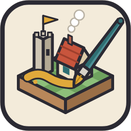
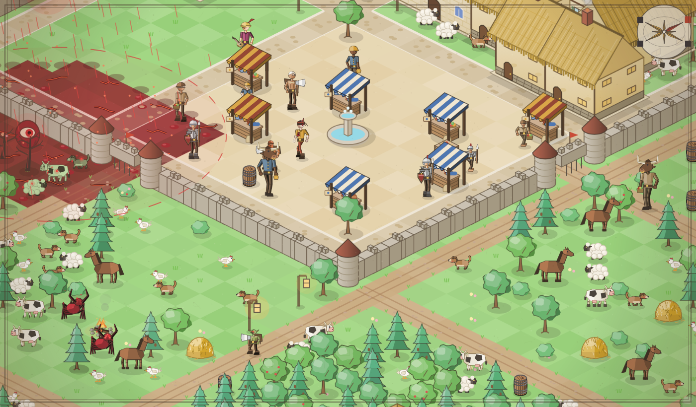
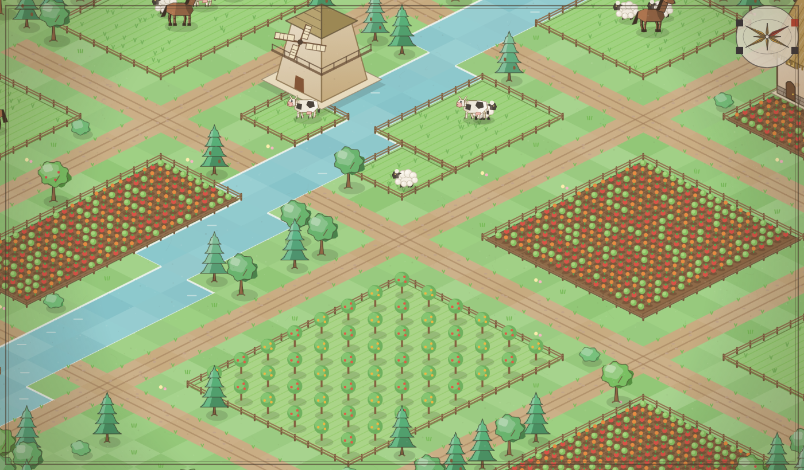
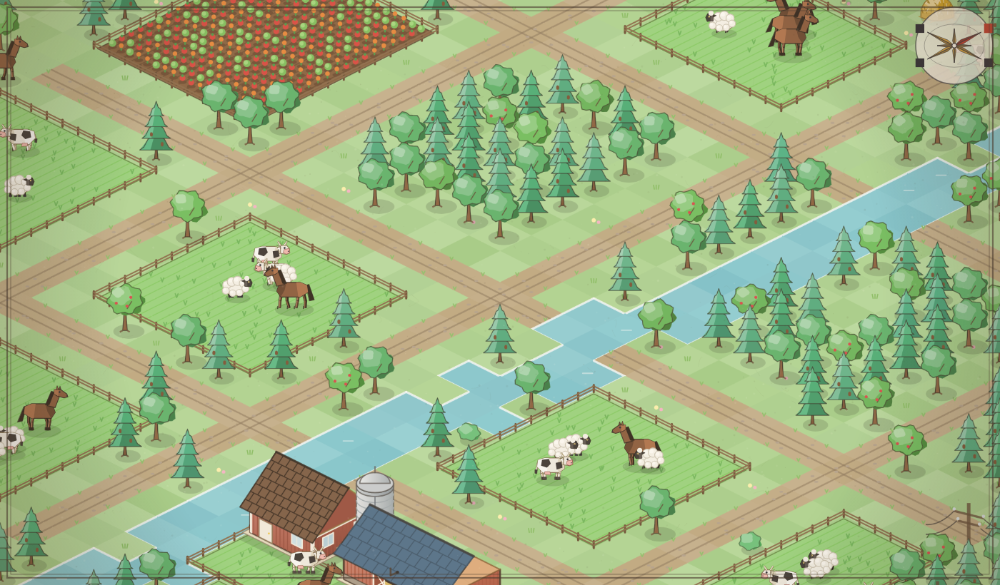
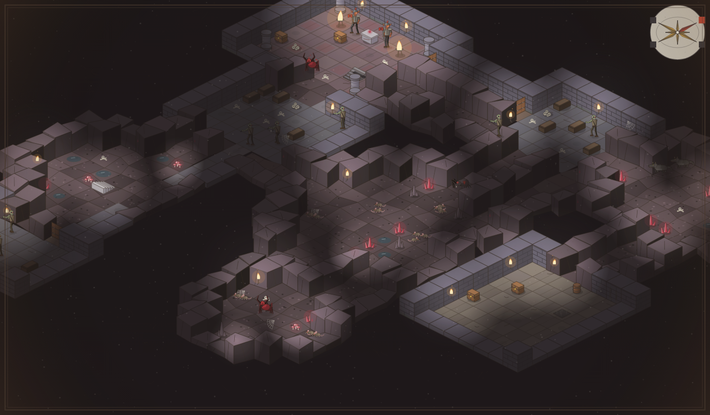
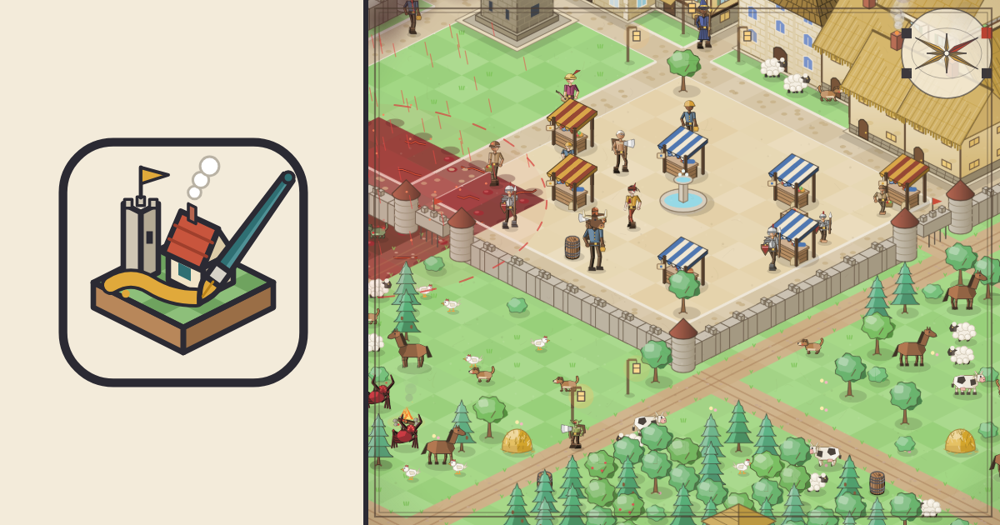

<div align="center">



# Burgo

**Gerador e editor de cidades e masmorras isométricas para RPG de mesa**

Tormenta20 · Dungeons & Dragons 5e · Tales from the Loop · Fantasia genérica

[**▶ Abrir o Burgo no navegador**](https://thauanny.github.io/burgo/)

[](https://thauanny.github.io/burgo/)
[](https://flutter.dev)
[](https://github.com/Thauanny/burgo/actions)



</div>

---

O **Burgo** gera, em segundos, mapas prontos para a sua mesa: cidades muradas, vilas, fazendas,
florestas e masmorras, cada uma no estilo do seu cenário. Depois, você edita tudo como num programa
de pintura: pinta ruas e muros, coloca casas, barracas, cercas, plantações, personagens e monstros,
e exporta a imagem. É gratuito e roda direto no navegador, sem instalar nada.

## Sumário

- [Destaques](#destaques)
- [Galeria](#galeria)
- [Funcionalidades](#funcionalidades)
- [Como usar](#como-usar)
- [Rodar localmente](#rodar-localmente)
- [Arquitetura](#arquitetura)
- [Publicação e busca no Google](#publicação-e-busca-no-google)
- [Créditos e aviso legal](#créditos-e-aviso-legal)

## Destaques

- **Cidades oficiais dos cenários**, recriadas a partir dos mapas publicados: Valkaria, Vectora,
  Malpetrim, Smokestone, Waterdeep, Baldur's Gate, Neverwinter, as ilhas Mälaren e outras.
- **Cada cenário com a sua cara**: arquitetura, época, paleta, nomes de lugares, população e monstros
  de cada sistema, sem misturar estilos.
- **Vida no mapa**: pessoas de cada classe e raça andando pelas ruas, animais nos pastos, monstros
  acampados fora da cidade e fumaça saindo das chaminés.
- **Masmorras ligadas à cidade**: cada entrada de masmorra no mapa abre um piso inferior com
  cavernas, escuridão, tochas e os monstros do cenário.
- **Editor completo, com desfazer e refazer**, vista isométrica ou de cima, giro do mapa, projetos
  salvos no navegador e exportação em PNG.

## Galeria

| | |
| :---: | :---: |
|  |  |
| Vila agrícola de fronteira (D&D 5e) | Fazendas ao redor do Loop (Tales from the Loop) |
|  |  |
| Masmorra de Tormenta20 | Ícone e uma cidade com feira |

## Funcionalidades

### Geração de mapas

- **Geração procedural com semente**: a mesma semente sempre gera o mesmo mapa, para você
  compartilhar ou voltar a ele.
- **Composições**: cidade + fazendas, só cidade, só fazendas, só floresta ou terreno vazio para
  construir do zero.
- **Tamanho do mapa**: tamanhos prontos e setas nas bordas para aumentar só o lado que você quiser
  (o mapa pode ser retangular).
- **Distância das fazendas**: controla quantos blocos ficam entre a cidade e as plantações.
- **Rios, lagos, mar, florestas, montanhas e relevo**, conforme o bioma do lugar.

### Cenários e cidades oficiais

| Sistema | Lugares |
| --- | --- |
| **Tormenta20** | Valkaria (oval, estátua colossal, bairros oficiais), Vectora (ilha voadora), Malpetrim, Smokestone, Sambúrdia, Nitamu-ra, Lenórienn, Norba, Pondsmânia, cidade militar, distrito de engenhocas e cidade livre |
| **D&D 5e** | Waterdeep, Baldur's Gate, Neverwinter, Phandalin, Bryn Shander, Alto Bosque, vila de fronteira e cidade livre |
| **Tales from the Loop** | Ilhas Mälaren, Boulder City, Mercer, fazendas do Loop, instalação do Loop e floresta |
| **Fantasia genérica** | Cidade medieval para qualquer mesa |

- **Época de cada lugar**: Smokestone é faroeste dentro de Arton; o Loop são os anos 80. As
  construções e os objetos seguem a época do lugar.
- **Áreas especiais** (Área da Tormenta, campo do Loop, magia selvagem de D&D): vêm ligadas só nas
  cidades livres. Nos outros lugares você liga quando quiser, e as árvores e os animais dentro da
  área ficam "contaminados" conforme o cenário.

### Editor

| Grupo | Ferramentas |
| --- | --- |
| Navegar | **Mover** (arrasta o mapa; um clique mostra as opções do item) e **Selecionar** (arrasta itens para outro lugar) |
| Terreno | **Ruas** (calçada, estrada de terra e praça), **Água**, **Muros** (muralha de pedra com torres, paliçada de madeira, muro baixo, cerca de madeira e sebe, cada um com o seu **portão**) e **Área especial** (pincel ou círculo com raio) |
| Construir | **Construir** (tipo, andares, largura, profundidade, telhado, cores, chaminé), **Fazenda** (plantações, casa de campo, celeiro, estábulo, silo, moinho, cercas, casinha de cachorro, feno, carroça, espantalho e animais), **Objetos** (natureza, vila e praça, água e porto, tecnologia e magia) e **Personagens** |
| Anotar | **Marcador** com nome e **Régua** de distância, com escala em km |
| Apagar | Remove qualquer item com um clique |

- **Pré-visualização**: o item aparece "fantasma" sob o cursor antes de você clicar, verde se cabe
  ali e vermelho se não cabe.
- **Cercas e muros se ligam** aos vizinhos sozinhos; uma rua cruzando a muralha vira portão.
- **Portões de cada muro**: arco de pedra com grade, portão de madeira entre mourões, porteira do
  muro baixo, porteira de cerca e arco da sebe. Clique no portão de novo para fechá-lo.
- **Girar casas e objetos**: as setas ↺ e ↻ acima do item selecionado (ou do último colocado)
  giram 90° (também no painel). A casa troca largura por profundidade; com a frente virada para
  trás, a porta fica escondida, como na vista de verdade.
- **Entrada de masmorra** é criada e apagada pela seção Pisos (Criar piso inferior › Escolher no
  mapa); no mapa ela não se seleciona nem se apaga, para não quebrar o piso de baixo.
- **Desfazer e refazer** (Ctrl/⌘+Z e Ctrl/⌘+Shift+Z).

### Personagens, monstros e população

- **Classe e raça separadas**: escolha a classe ou ocupação e a raça. Em Tormenta20 há as 14
  classes e as 17 raças do livro básico, com os nomes do livro (Arcanista, Caçador, Lutador,
  Hynne...). Em D&D 5e há as classes e as raças do Livro do Jogador.
- **Monstros de cada sistema**: goblins, hobgoblins, orcs, esqueletos, zumbis, trolls, lefeu,
  observadores, ursos-coruja, dragões, aranhas gigantes, cubos gelatinosos e outros.
- **Controle de população**: defina quantas pessoas vivem na cidade e quantos monstros acampam fora
  dela. As raças seguem a demografia pesquisada de cada cidade (por exemplo, a Favela dos Goblins e
  a Vila Élfica em Valkaria, ou anões e halflings em Phandalin).
- **Movimento**: pessoas andam pelas ruas e praças, animais no pasto e monstros perto do
  acampamento, sem atravessar casas, árvores ou cercas. O **raio de movimento** vale para todos de
  uma vez (em População) ou para um só (clicando nele). As animações de pessoas, monstros e animais
  podem ser ligadas e desligadas separadamente.

### Masmorras

- **Estilo por cenário**: ruínas e cavernas de Arton com cristais rubros, o Subterrâneo de D&D com
  fungos luminosos e teias, e os túneis e o bunker de concreto do Loop.
- **Cavernas e salas construídas**, corredores, portas, escadas, sala do chefe, criptas e tesouros.
- **Escuridão** que só abre em volta de tochas, braseiros, cristais e cogumelos.
- **Monstros nos lugares certos**: bichos nos corredores, bandos nos alojamentos, mortos-vivos nas
  criptas e o chefe na sala do chefe.
- **Os mesmos controles do piso de cima**: zoom, giro, vista de cima e exportação.

### Visualização e projetos

- **Vista isométrica ou de cima**, giro em passos de 90° com animação, bússola e barra de escala.
- **Abas**: vários projetos abertos ao mesmo tempo (cidade, fazendas, masmorra).
- **Salvamento automático** no navegador e uma biblioteca de projetos salvos.
- **Exportar e importar** em `.json`, que reabre exatamente igual. Ao exportar, copiar como texto
  ou copiar o link, com várias abas abertas, escolha **uma aba específica** ou **o projeto inteiro**
  (todas as abas, que reabrem cada uma na sua aba).
- **Exportar imagem PNG** do mapa inteiro, em vista isométrica ou de cima.
- **Compartilhar por link** (Arquivo › Copiar link para compartilhar): um mapa sem edições vira um
  link curto com a receita (sistema, lugar, semente); um mapa editado vai inteiro, comprimido, no
  próprio link. Quem abre vê o mesmo mapa numa aba nova. Nada passa por servidor.
- **Aviso de não salvo**: a aba com mudanças ainda não salvas na biblioteca nem exportadas ganha uma
  bolinha; fechar essa aba ou a página pede confirmação.

## Como usar

1. Abra **[thauanny.github.io/burgo](https://thauanny.github.io/burgo/)**.
2. Na aba **Mapa**, escolha o sistema e o lugar, a composição e a semente, e clique em
   **Gerar nova**.
3. Na aba **Editar**, escolha uma ferramenta: as opções dela aparecem logo abaixo. Clique num item
   do mapa para ver e mudar as opções dele.
4. Em **População**, ajuste quantas pessoas e monstros há e quanto eles andam.
5. Em **Arquivo**, salve o projeto ou exporte a imagem.

## Rodar localmente

Requisitos: [Flutter](https://docs.flutter.dev/get-started/install) 3.38 ou mais novo (canal stable).

```bash
git clone https://github.com/Thauanny/burgo.git
cd burgo
flutter pub get
flutter run -d chrome          # sem internet: flutter run -d chrome --no-web-resources-cdn
```

Qualidade e testes:

```bash
flutter analyze
flutter test
```

Ícones, imagem de compartilhamento e capturas deste README são gerados pelo próprio código de
desenho do app:

```bash
flutter test tool/make_assets_test.dart
```

## Arquitetura

Toda a arte (casas, personagens, monstros, terreno) é desenhada em código com o `Canvas` do Flutter,
sem imagens de terceiros. Os seres vivos viram *sprites* em cache, e cada item parado fica gravado em
imagens por faixa de profundidade, para o mapa ficar leve mesmo com centenas de bonecos andando.

```text
lib/
├── domain/       modelos do mapa (cidade, masmorra, itens, épocas, regras de colocação)
├── geometry/     projeção isométrica e vista de cima, giro do mapa
├── generation/   geradores de cidade, mapas oficiais e controle de população
├── dungeon/      gerador e editor de masmorras
├── systems/      cenários: identidade visual, lugares, populações e perfis de masmorra
├── editor/       estado do editor, câmera, histórico e ferramentas
├── render/       camadas de desenho, sprites, caminhos dos seres vivos e exportação PNG
├── persistence/  formato dos arquivos e armazenamento no navegador
├── project/      abas, pisos e projetos
└── ui/           painéis, menus e componentes visuais
```

## Publicação e busca no Google

O app é publicado no **GitHub Pages** a cada push na branch `main`
(`.github/workflows/deploy.yml`), em `https://thauanny.github.io/burgo/`.

Para o site ser encontrado nas buscas, o `web/index.html` traz título e descrição, idioma
`pt-BR`, endereço canônico, Open Graph e Twitter Cards (prévia ao compartilhar), dados estruturados
`WebApplication` (schema.org) e um texto descritivo legível pelos buscadores, já que o app em si é
desenhado num canvas. Há também `sitemap.xml` e `robots.txt`.

Para acelerar a indexação:

1. Abra o [Google Search Console](https://search.google.com/search-console) e adicione a
   propriedade com o prefixo de URL `https://thauanny.github.io/burgo/`.
2. Verifique a propriedade pelo método **tag HTML**: copie a `<meta name="google-site-verification" ...>`
   para dentro do `<head>` de `web/index.html` e publique.
3. Em **Sitemaps**, envie `https://thauanny.github.io/burgo/sitemap.xml`.
4. Em **Inspeção de URL**, peça a indexação da página inicial.

## Créditos e aviso legal

O Burgo é uma ferramenta de fã, gratuita e sem fins lucrativos. Tormenta e Tormenta20 são marcas da
Jambô Editora; Dungeons & Dragons e os Reinos Esquecidos são marcas da Wizards of the Coast; Tales
from the Loop é uma marca da Fria Ligan e de Simon Stålenhag. O Burgo não é afiliado a nenhuma delas.
Os nomes de lugares, classes, raças e monstros aparecem apenas como referência para mesas de RPG. As
fontes consultadas estão listadas no menu **Ajuda › Créditos** do app.
